## About me

- **Current favorite language:** Rust
- **Languages I use:** Rust, TypeScript, Go, and occasionally C++
- **Interests:** Game modding & reverse engineering sometimes

## Languages & tools

  

---

## GitHub metrics

---
